# Achmage Atelier

[](https://github.com/laguna821/obsidian-achmage-atelier/actions/workflows/validate.yml)

A minimal Obsidian theme inspired by Apple’s Human Interface Guidelines, with refined light and dark modes.

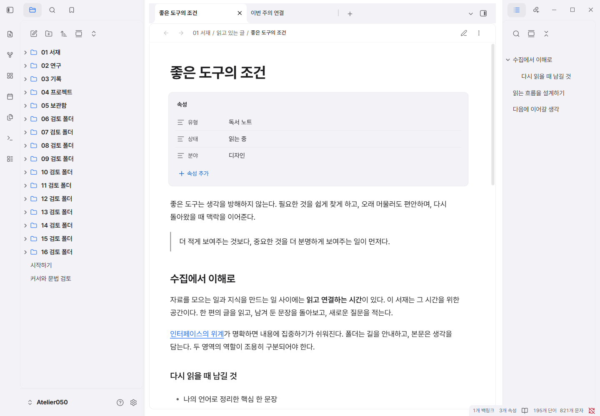

## A quieter place to read

- Neutral light and dark surfaces with blue accents and gently separated panels.
- Embedded **Pretendard Variable** for Korean and Latin text. No font installation or network connection required.
- Considered typography for headings, quotes, properties, links, code, tables and tasks.
- Consistent search results, command palettes, menus, settings and keyboard focus.
- Compact mobile navigation, scalable UI text and focus-aware current-line highlighting.
- Restrained translucent palettes and menus, with an optional opaque-surface snippet.
- Optional **Notebook Navigator** styling. Minimal, Minimal Theme Settings and Style Settings are not required.

## Install

This theme is currently distributed through GitHub Releases. It has not yet been listed in Obsidian's community theme directory.

1. Download `theme.css` and `manifest.json` from the [latest release](https://github.com/laguna821/obsidian-achmage-atelier/releases/latest).
2. Inside your vault, create `.obsidian/themes/Achmage Atelier/`.
3. Place both files in that folder.
4. In Obsidian, open **Settings → Appearance → Themes**, then select **Achmage Atelier**.
5. Use Obsidian's base color scheme setting to choose light or dark.

An installable ZIP is also provided in each release. Extract its `Achmage Atelier` folder into `.obsidian/themes/`.

To use the embedded font, leave Obsidian's interface and text font overrides empty. Your existing font overrides, accent color and CSS snippets can affect the appearance.

### Prefer opaque surfaces?

Copy [Atelier Opaque Surfaces.css](snippets/Atelier%20Opaque%20Surfaces.css) into `.obsidian/snippets/`, refresh the snippet list in **Settings → Appearance**, and enable it. No settings plugin is needed.

The theme also responds to reduced-motion, increased-contrast and reduced-transparency media preferences where the host exposes them.

## Screenshots

All screenshots show actual Obsidian windows with synthetic sample notes.

| Light | Dark |
| --- | --- |
|  | 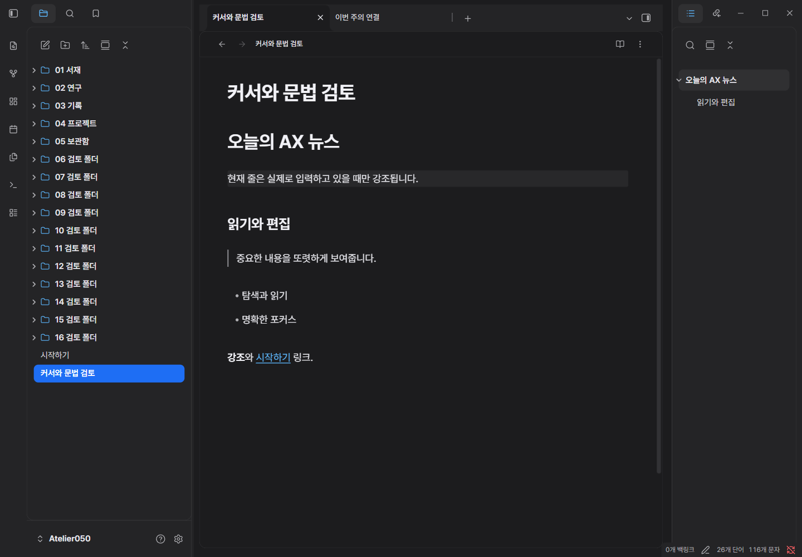 |
| 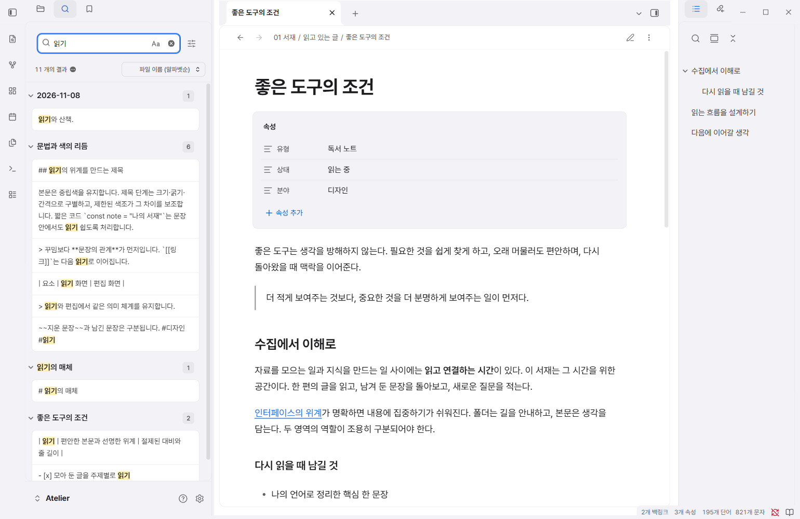 | 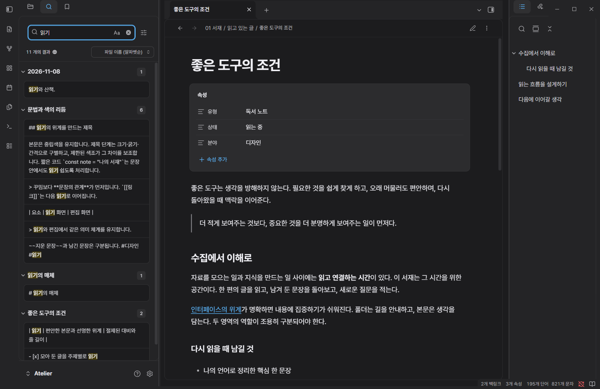 |
| 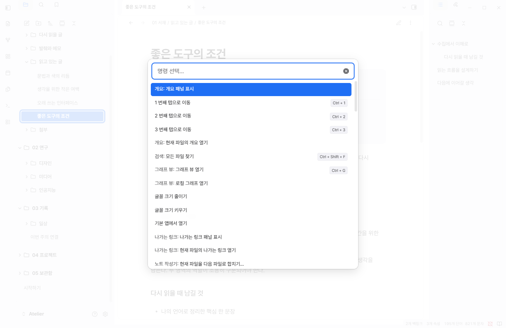 | 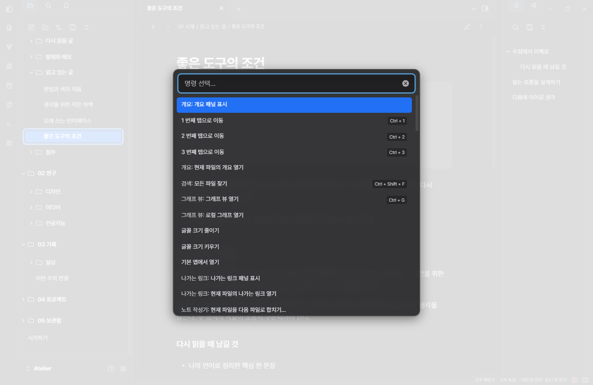 |
| 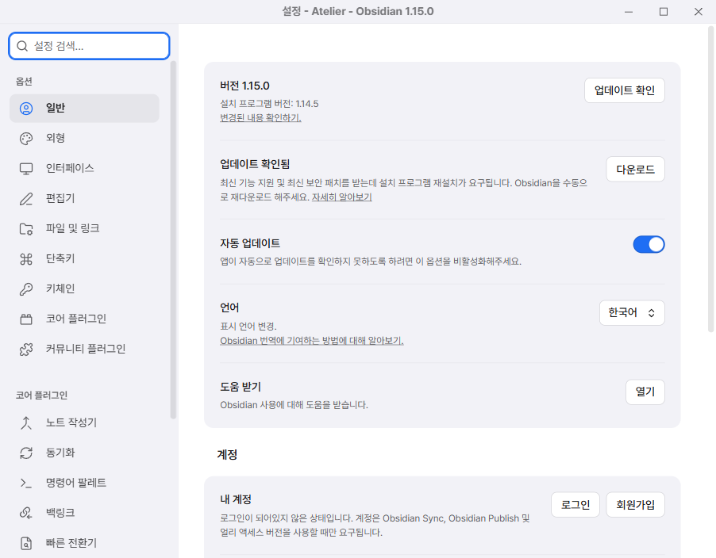 | 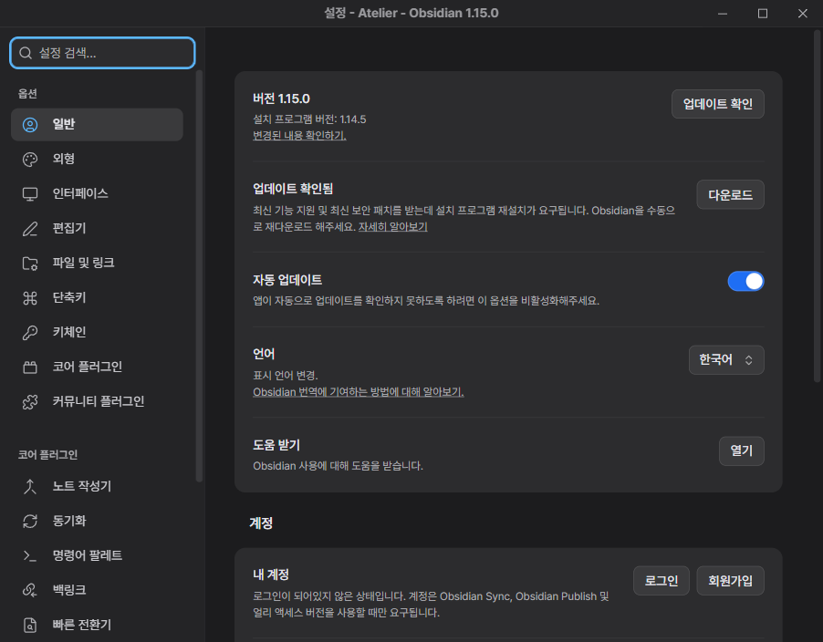 |

<details>
<summary>Notebook Navigator</summary>

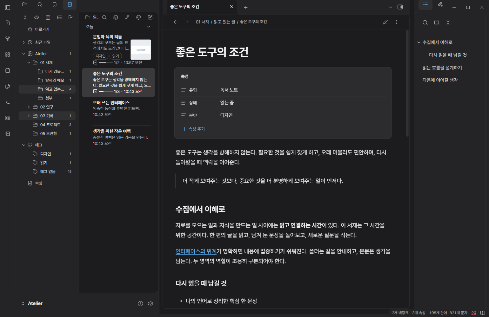

</details>

<details>
<summary>Mobile layout preview (Windows emulation, 0.5.0)</summary>

These are Obsidian's mobile emulation on Windows, not screenshots from an iPhone.

| Navigation | Command palette |
| --- | --- |
| 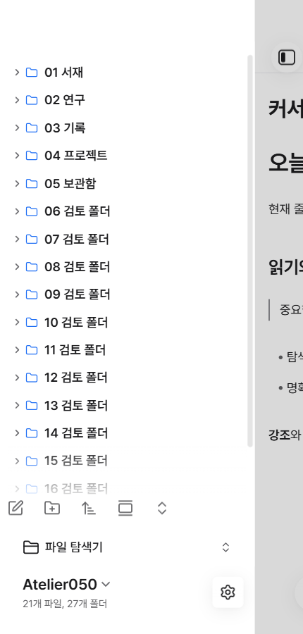 | 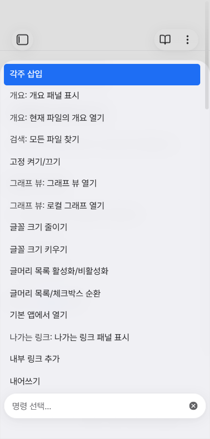 |
| 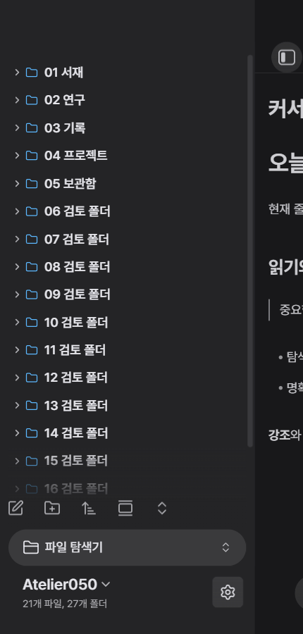 | 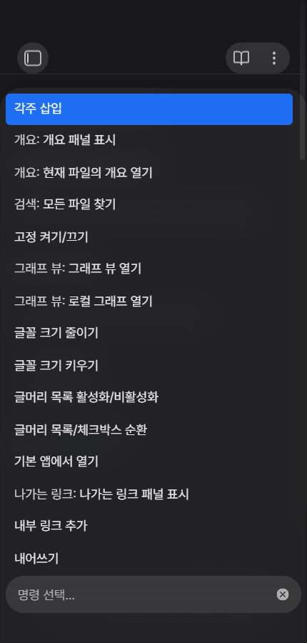 |

</details>

## Compatibility

- Minimum app version declared: **Obsidian 1.14.5**.
- Visually and interactively tested on **Windows, Obsidian 1.15.0**.
- Notebook Navigator styling checked with **3.5.0**.
- Mobile layouts additionally checked using Obsidian's Windows mobile emulation; this is not an iOS or Android device test.
- macOS, Linux and real mobile device validation is still pending.

The theme styles Obsidian's existing controls. Translucent surfaces are CSS effects; the separate settings window uses opaque internal surfaces.

See [compatibility notes](docs/compatibility.md) for the tested scope.

See [community review preflight](docs/community-review.md) for the official scanner checks and remaining compatibility warnings.

## Development

Requires Node.js 22.12+ and npm.

```sh
npm ci
npm run build
npm run check
```

Edit `src/`, then rebuild `theme.css`. The build embeds the bundled font and does not download assets. `npm run check` runs Obsidian's official Stylelint configuration and verifies the distributable, licenses and local asset references.

## Credits and license

Theme code: [MIT](LICENSE), © 2026 laguna821.

[Pretendard](https://github.com/orioncactus/pretendard) 1.3.9 is bundled unchanged under the [SIL Open Font License 1.1](assets/fonts/OFL.txt). Third-party notices are in [THIRD-PARTY-LICENSES.txt](THIRD-PARTY-LICENSES.txt).

Inspired by Apple's Human Interface Guidelines. This is an independent project and is not affiliated with, endorsed by or certified by Apple. Apple is a trademark of Apple Inc.
